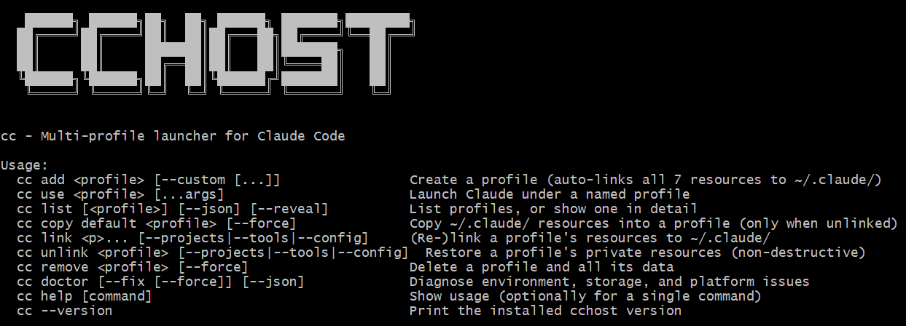

# cchost

> **nvm, but for your Claude Code accounts.** Works on Windows, Linux, and macOS — see [Platform notes](#platform-notes) for macOS credential-storage caveats.

[](https://www.npmjs.com/package/cchost)
[](https://github.com/allenhack638/cchost/actions/workflows/ci.yml)
[](./LICENSE)
[](https://nodejs.org)
[](#install)

<p align="center">
  
</p>

`cchost` is a multi-account profile manager for [Claude Code](https://code.claude.com).

- **Isolated credentials** — each profile is a complete `CLAUDE_CONFIG_DIR` with its own login, endpoint, and credential files. Credentials are never copied between profiles (on macOS, see [Platform notes](#platform-notes) for Keychain caveats). Switch with `cc use <name>`.
- **Shared tooling and history by default** — `skills/`, `agents/`, `commands/`, `projects/`, and the config files (`mcp.json`, `settings.json`, `CLAUDE.md`) link across all profiles. That includes session transcripts and code-executing config; see [Sharing model](#sharing-model) before using profiles for separated trust boundaries.
- **Custom endpoints** — route a profile through any Anthropic-compatible API (Moonshot, OpenRouter, self-hosted vLLM, corporate proxies) instead of Anthropic OAuth.
- **Zero runtime dependencies** — single Node CLI on your `PATH`. Identical behavior across PowerShell, cmd, bash, zsh, and fish.

## Install

```
npm install -g cchost
```

Requires Node.js 18+ and Claude Code 2.1.140+ (`npm install -g @anthropic-ai/claude-code`).

## Quickstart

```bash
cc add work             # create a profile
cc use work             # launch Claude under it (prompts for login on first run)
cc use work --resume    # resume the last conversation
cc list                 # see all profiles
cc remove old-profile   # delete a profile
```

## Commands

| Command | What it does |
| --- | --- |
| `cc add <profile>` | Create a subscription profile. Logs in via Anthropic OAuth on first `cc use`. Auto-shares all 7 resources with `~/.claude/`. |
| `cc add <profile> --custom [...]` | Create or edit a custom-endpoint profile. Interactive wizard, or `--base-url=URL --token=TOKEN [--model=…]`. See [Custom endpoints](#custom-endpoints). |
| `cc use <profile> [...args]` | Launch Claude under that profile. Extra args are forwarded to `claude`. |
| `cc list [<profile>] [--json] [--reveal]` | List all profiles or show one in detail. Emails and tokens are masked by default; `--reveal` prints them in full. |
| `cc copy default <profile> [--force]` | Seed an unlinked profile resource from `~/.claude/`. No-op for fully-shared profiles. |
| `cc link <profile> [--projects\|--tools\|--config]` | Link a profile's resources to `~/.claude/`. Defaults to all 7 when no flag is passed. |
| `cc unlink <profile> [--projects\|--tools\|--config]` | Break the link and make those resources private to the profile. Non-destructive. |
| `cc remove <profile> [--force]` | Delete a profile. Requires typing the profile name. `--force` required when private resources exist. |
| `cc doctor [--fix [--force]] [--json]` | Diagnose environment, storage, and platform issues. `--fix` applies safe auto-fixes; `--force` is required for destructive ones. |
| `cc help [command]` | Print usage. |

Sample `cc list` output:

```
Profile   LoggedIn  Email                  Shared  Endpoint
kimi      false     -                      7/7     api.moonshot.ai
personal  true      p************.com      7/7     subscription
work      true      w************.com      7/7     subscription
```

The `Shared` column counts how many of the 7 shareable resources are linked into `~/.claude/`. `7/7` is the default; lower numbers mean one or more resources have been `cc unlink`ed and now hold private content.

## Sharing model

On Windows and Linux, anything that authenticates a profile stays per-profile and everything else is shared. On macOS, OAuth credentials live in the login Keychain rather than the profile directory — see [Platform notes](#platform-notes).

| Resource | Shared by default | Flag group |
| --- | :---: | --- |
| `projects/` | ✓ | `--projects` |
| `skills/`, `agents/`, `commands/` | ✓ | `--tools` |
| `mcp.json`, `settings.json`, `CLAUDE.md` | ✓ | `--config` |
| `.credentials.json`, `.claude.json`, `.cc-env.json` | never | — |
| `sessions/`, `plugins/` | never | — |

Sharing uses POSIX symlinks on Linux/macOS and directory junctions on Windows (no admin or Developer Mode required). File resources fall back to a hard link on Windows when symlink creation would require elevation. Note that `mcp.json` and `settings.json` can execute arbitrary code through MCP servers and hooks — if a profile needs an isolated copy of either, run `cc unlink <profile> --config`.

> **Privacy note:** the defaults above are convenient, not isolated. `projects/`
> contains full conversation transcripts, and `settings.json` / `mcp.json` can
> execute hooks and MCP servers. For a work/personal split, unlink the resources
> that must not cross over before first use, or use a separate OS account.

To break sharing for a single profile:

```bash
cc unlink work --tools     # private skills/agents/commands
cc unlink work --projects  # private projects/
cc unlink work --config    # private mcp.json/settings.json/CLAUDE.md
cc unlink work             # all 7 private
cc link work --tools       # re-share
```

`cc unlink` is non-destructive — pool content is copied into the profile before the link is broken. `cc link` refuses to overwrite existing private content; remove or relocate the private resource manually, then re-run.

Use `cc copy default <profile>` to seed an unlinked resource from the current `~/.claude/`. For fully-shared profiles this is a no-op.

## Custom endpoints

A profile can route through any Anthropic-compatible API — Moonshot/Kimi, OpenRouter, Requesty, self-hosted vLLM, or a corporate proxy — instead of Anthropic's subscription OAuth.

> **Billing:** custom-endpoint profiles bill through the **third-party provider**, not your Anthropic subscription.

```bash
cc add kimi --custom --base-url=https://api.moonshot.ai/anthropic \
                     --token=sk-your-key \
                     --model=kimi-k2.5
cc use kimi
```

Run `cc add <profile> --custom` with no value flags for an interactive wizard — it prompts for every field and never echoes the token. Re-running on an existing custom-endpoint profile enters **edit mode**: the wizard prefills current values, and with flags only the flags you pass are changed.

```bash
cc add kimi --custom --model=kimi-k3      # change just the model
cc add kimi --custom --token=sk-rotated   # rotate the API key
```

Subscription and custom-endpoint profiles are mutually exclusive: a profile is either one or the other for its entire lifetime. To switch, remove the profile with `cc remove` and recreate it.

Inspect with `cc list <profile>` (token masked) or `cc list <profile> --reveal` (full). The endpoint URL should not include `/v1` — Claude Code appends `/v1/messages` itself. Most providers serve a single model; `--model` applies to every tier (`opus`/`sonnet`/`haiku`/`subagent`), or override per-tier with `--opus=`, `--sonnet=`, etc.

On launch, `cc use` prints a one-line endpoint banner to stderr:

```
[cchost] Profile 'kimi' → api.moonshot.ai (custom endpoint billing applies)
```

## Platform notes

### macOS

Claude Code stores OAuth credentials in the login **Keychain**, not in
`<profile>/.credentials.json`. Two things follow:

- `cc list`'s `LoggedIn` column checks only for `.credentials.json`, so it can
  show `false` for a profile that is actually logged in. This is a known display
  limitation, not a logout.
- Isolation between subscription (OAuth) profiles on macOS has not been verified
  against two real accounts. Claude Code's Keychain item is shared per macOS
  login user; if it is not namespaced per `CLAUDE_CONFIG_DIR`, profiles may share
  one login. Tracked upstream at
  [anthropics/claude-code#20553](https://github.com/anthropics/claude-code/issues/20553).

If you need guaranteed separation on macOS today, use **custom-endpoint
profiles** (each has its own token in `.cc-env.json`) or separate macOS user
accounts. Do not treat the `LoggedIn` column as proof of which account a
profile will use.

### Windows and Linux

Credentials are file-based (`.credentials.json` in the profile directory), so
the `LoggedIn` column reflects the profile's own credential file.

## Security

`~/.claude-profiles/<profile>/` holds real OAuth credentials and API keys. Treat it like `~/.ssh`: don't commit it, don't share it, don't sync it to public cloud storage. The shipped `.gitignore` excludes profile directories. `cc copy` and `cc link` never touch credential files (`.credentials.json`, `.claude.json`, `.cc-env.json`); each profile keeps its own auth state. On macOS, OAuth tokens are stored in the login Keychain instead — see [Platform notes](#platform-notes).

## Troubleshooting

Run `cc doctor` first — it checks Node, Claude Code version, profile integrity, symlinks, and the shared pool.

**`Claude Code does not appear to be installed`** — install with `npm install -g @anthropic-ai/claude-code` and verify `claude --version` runs in a fresh terminal.

**`warning: Claude Code <version> is older than 2.1.140`** — earlier versions on Windows read `.claude.json` from `%USERPROFILE%` regardless of `CLAUDE_CONFIG_DIR`, breaking isolation. Run `claude update`.

**`Profile "<name>" does not exist`** — `cc use` does not auto-create profiles. Run `cc add <name>` first.

**Profile name rejected** — names must not contain path separators, whitespace, `..`, leading dots, or DOS reserved names (`CON`, `PRN`, `COM1`…). Use letters, digits, dashes, and underscores.

## License

MIT
